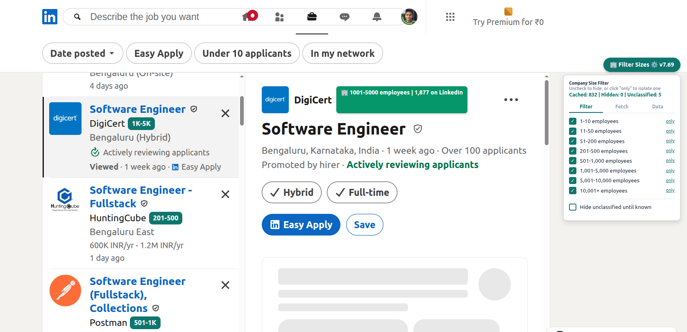
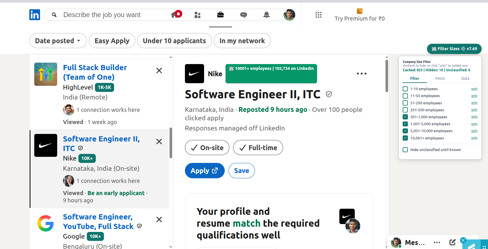
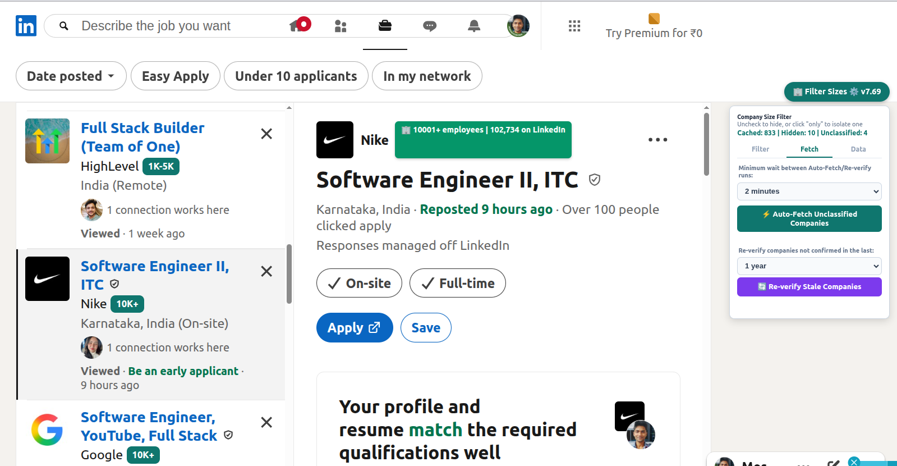
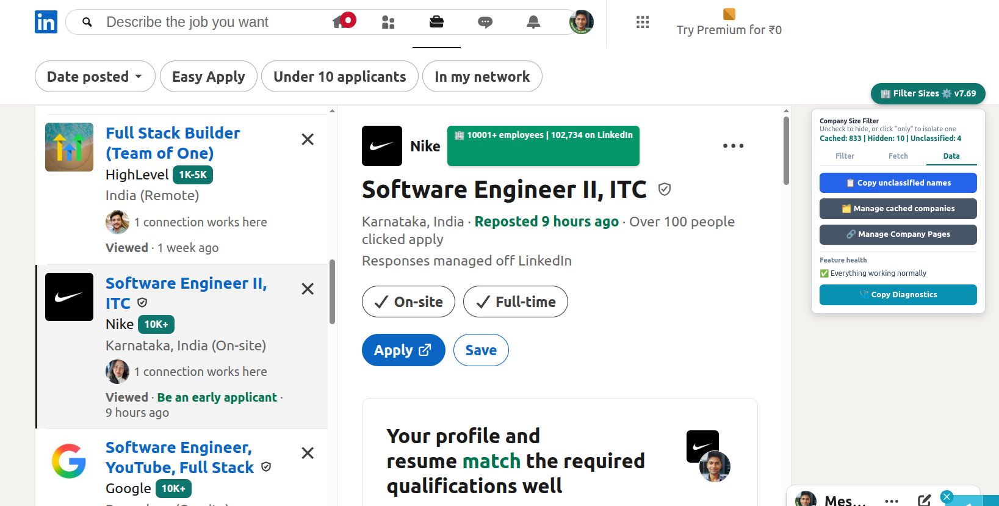
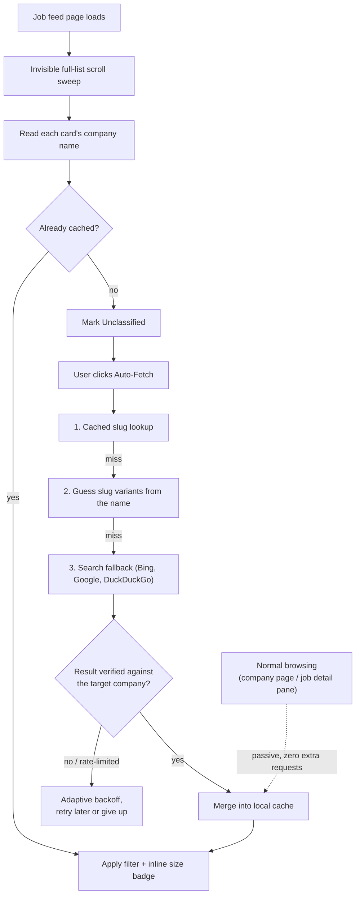

<!-- markdownlint-disable MD033 -->
# HeadcountFilter

**A self-healing browser tool that adds company-headcount filtering to LinkedIn's job feed** — something LinkedIn's own filters don't offer. Runs entirely client-side, with zero backend and zero data collection.

  

<!-- TODO: swap for a GIF — panel open, unchecking a size bucket, cards fading out live. -->


## Why this exists

LinkedIn lets you filter jobs by date posted, experience level, remote/on-site — but not by **company size**. If you specifically want early-stage startups (or specifically want to avoid them, or only want enterprise-scale companies), there's no native way to do that. You end up opening every job, checking the company's profile by hand, and closing the ones that don't fit. I built this to automate that for my own job search — it now runs entirely in the background while I browse normally.

## What it does

- **Filter Sizes panel** — a checklist of LinkedIn's 8 size buckets (1–10 employees … 10,001+). Uncheck a bucket to hide its job cards; "only" isolates a single bucket. A live counter shows how many cards on screen are Cached / Hidden / Unclassified.

- **Full feed coverage** — LinkedIn only renders job cards near your current scroll position, so without this, filtering would silently only apply to the handful of cards already in the DOM. The script sweeps the entire list once per page load, then restores your exact scroll position — invisibly, with no visible jump or flash.

- **Auto-Fetch Unclassified Companies** — for companies not yet known, resolves their size anonymously (no logged-in session cookies ever sent), in order: previously-discovered slug → guessed slug variants from the company name → search-engine fallback (Bing → Google → DuckDuckGo). Backs off adaptively if it hits rate-limit responses, and stops itself rather than escalating indefinitely.

- **Passive capture (free)** — while you browse normally — opening a company page, opening a job's detail pane — the script reads the size that's already sitting on the page. No extra requests, and it's the most reliable source: LinkedIn often hides the size field from anonymous lookups but shows it to a real logged-in view.

- **Inline size badges** — every job card in a list shows a compact size badge next to the company name (e.g. "51-200") so the whole feed is scannable at a glance, not just the one job you have open.

- **Re-verify Stale Companies** — company headcounts drift over time (a 201-500 startup today can be 1,000+ a year later); this periodically re-checks classifications older than a configurable threshold instead of letting them go stale forever.

- **Manage cached companies** — a JSON editor over the full cache, plus Export/Import that **merges** rather than overwrites, so restoring a backup can't clobber data the browser has since learned on its own.

- **Rate-limit aware** — Auto-Fetch and Re-verify share a configurable cooldown between runs, which scales up automatically (2x, then 4x) if the previous run actually hit rate-limiting — protecting the account without needing to think about it.

## Screenshots

| | |
|---|---|
|  **Filtering applied** — small-company buckets unchecked, 10 cards hidden from the feed. |  **Fetch tab** — Auto-Fetch Unclassified Companies and the Re-verify Stale Companies sweep, with the cross-run cooldown control. |
|  **Data tab** — cache management, backup/restore, and the live feature-health / diagnostics tools. | *(GIF coming in a follow-up push: toggling a size bucket and watching cards filter live.)* |

## Install

[](https://raw.githubusercontent.com/Manish814142/HeadcountFilter/main/headcount-filter.user.js)

1. Install the [Tampermonkey](https://www.tampermonkey.net/) browser extension, if you don't already have it.
2. Click the badge above — Tampermonkey recognizes the raw `.user.js` file and prompts you to install it directly.
3. Visit any `linkedin.com` page — a **"Filter Sizes"** button appears.

<details>
<summary>Manual install (if the badge doesn't trigger a prompt)</summary>

1. Open Tampermonkey → **Create a new script**.
2. Delete the placeholder content and paste in the full contents of <code>headcount-filter.user.js</code>.
3. Save (Ctrl+S).

</details>

## Privacy & Account Safety

- **No data collection** — everything runs client-side in your browser. There's no backend, no analytics, no telemetry. The only domains this script ever contacts are `linkedin.com` (pages you're already browsing) and `bing.com` / `google.com` / `duckduckgo.com` (to locate a company's LinkedIn page when guessing fails) — exactly the domains declared in the script's own `@connect` allowlist, nothing more.
- **Session-safe by design** — every outbound lookup goes through one function, `makeAnonymousRequest()`, which explicitly sets `anonymous: true` and strips all logged-in cookies before the request goes out, so none of this can touch your LinkedIn session or put the account at risk.

## Usage

1. Click **Filter Sizes** to open the panel.
2. Uncheck any size bucket to hide those companies' jobs from the feed (or click **only** on a bucket to isolate it).
3. Click **Auto-Fetch Unclassified Companies** to resolve companies not yet in the cache — safe to leave running in the background; it's cancellable at any time.
4. Everything persists locally (`localStorage`) — the cache only grows the more you browse.

## Under the hood

The interesting engineering problem here isn't the filtering logic — it's that LinkedIn's markup changes without notice, and a userscript with no error reporting or user base to complain will just quietly stop working. Most of the actual effort went into making failures visible and survivable instead of silent.

**Company-size resolution pipeline:**



- **Self-healing extraction** — every DOM read that matters (company name, job title, etc.) goes through a ranked fallback chain of selectors rather than one hardcoded guess, with live hit-rate tracking recording which selector actually won on each read.
- **Zero-dependency diagnostics** — a "Copy Diagnostics" button dumps a full report (feature health per subsystem, selector hit rates, DOM structure snapshots) as plain text. Every bug in this project's history was fixed from one of these reports — no server, no logging backend, no repro environment needed.
- **585-case regression suite, 100% passing** — re-reads the live script source on every run (rather than testing a hand-copied mirror of the logic) so a passing suite always reflects the code as it currently stands, not a stale snapshot.
- **79 shipped versions**, each gated on the full suite passing plus a custom dead-code audit before release — see [`CHANGELOG.md`](./CHANGELOG.md) for the version-by-version history.

## Testing

```bash
npm test
# or, to also syntax-check both files first:
npm run check
```

No external dependencies — the test suite uses only Node's built-in `fs`/`path`.

## License

[MIT](./LICENSE)
